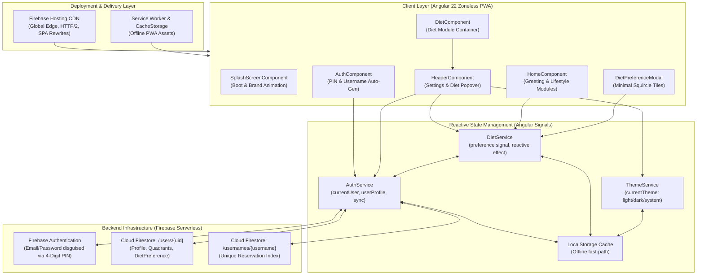
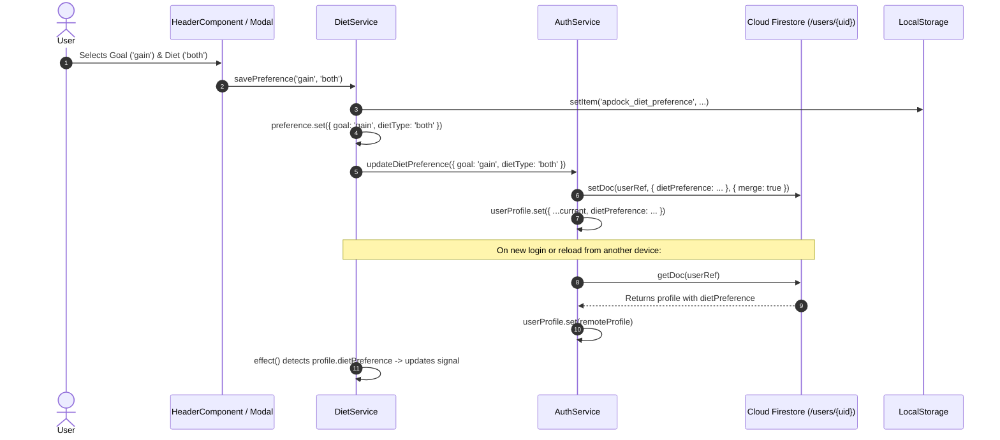

# apdock • Frontend & Backend Architecture

> **Application Overview**: apdock is a mobile-first Progressive Web Application (PWA) built with Angular 22 (Zoneless Signal Architecture), Firebase Auth, Cloud Firestore, and modern CSS Design Tokens. It provides a lifestyle dock space featuring custom authentication, dynamic handle generation, lifestyle modules, and real-time backend synchronization.

---

## 1. System Architecture Overview



---

## 2. Frontend Architecture (Angular 22 Zoneless)

### 2.1 Technical Foundation
- **Framework**: Angular v22.2.0 (Standalone Component Architecture, zero `NgModule`).
- **Change Detection**: Zoneless Reactive Signal Architecture (`provideExperimentalZonelessChangeDetection` via `@angular/build:application`).
- **Reactivity Model**: Fine-grained reactive primitives:
  - `signal()`: Writable atomic state.
  - `computed()`: Pure memoized derivations.
  - `effect()`: Synchronized reactive side-effects for storage and backend synchronization.
- **Routing**: Angular Router with functional guards:
  - `authGuard`: Enforces active session, redirecting unauthenticated users to `/auth`.
  - `guestGuard`: Prevents authenticated users from seeing sign-in/sign-up screens.

### 2.2 Component Hierarchy & Responsibilities

| Component | Path | Responsibility |
|---|---|---|
| **App Root** | `src/app/app.ts` | Hosts `<router-outlet>` and mounts `<app-splash-screen>`. |
| **SplashScreen** | `src/app/components/splash-screen/` | Brand boot animation with 4 signature quadrant dots (`amber`, `emerald`, `violet`, `coral`), smooth spring fade-out. |
| **AuthComponent** | `src/app/pages/auth/` | Two-screen authentication flow: PIN-based Sign In and auto-generating Sign Up with animated multi-step progress bar. |
| **HomeComponent** | `src/app/pages/home/` | Time-calibrated greeting ("Good morning / afternoon / evening") with dynamic user display name, lifestyle modules grid. |
| **HeaderComponent** | `src/app/components/header/` | Global navigation bar containing logo, user avatar, settings dropdown (theme switcher, PWA update trigger, sign out, account deletion) and contextual **Diet Preference Popover**. |
| **DietPreferenceModal** | `src/app/components/diet-preference-modal/` | Minimalist squircle tile modal for Goal (`loss`/`gain`) and Diet Preference (`veg`/`nonveg`/`both`). |
| **DietComponent** | `src/app/pages/diet/` | Minimal diet module container hosting `<app-header>` with contextual popover trigger and home navigation. |

### 2.3 State Management & Service Architecture

#### `AuthService` (`src/app/core/services/auth.service.ts`)
- Manages Firebase Auth lifecycle (`onAuthStateChanged`).
- Exposes `currentUser` signal and `userProfile` signal.
- Implements 4-digit PIN translation into secure hashed passwords.
- Handles atomic Firestore profile creation, username reservation, and session termination.
- Exposes `updateDietPreference(preference)` for persisting nutrition configurations.

#### `ThemeService` (`src/app/core/services/theme.service.ts`)
- Manages 3 theme modes: `'light'`, `'dark'`, and `'system'`.
- Applies dynamic `data-theme` attribute on `<html>` and updates `<meta name="theme-color">`.
- Monitors OS color scheme changes via `window.matchMedia('(prefers-color-scheme: dark)')`.

#### `DietService` (`src/app/core/services/diet.service.ts`)
- Single source of truth for user diet target (`goal: 'loss' | 'gain'`) and food preference (`dietType: 'veg' | 'nonveg' | 'both'`).
- **Reactive Bi-directional Sync**:
  1. **Immediate Local Cache**: Saves to `localStorage` key `apdock_diet_preference` instantly for zero-latency UI feedback.
  2. **Reactive Backend Effect**: Continuously observes `AuthService.userProfile()` via `effect()`. When an authenticated user profile updates or is hydrated from Firestore, `DietService.preference` updates automatically.
  3. **Backend Persistence**: Calling `savePreference(goal, dietType)` invokes `AuthService.updateDietPreference()`, merging the change into `/users/{uid}` in Firestore.

---

## 3. Backend Architecture (Firebase Serverless)

### 3.1 Cloud Infrastructure Stack
- **Authentication**: Firebase Authentication (Email/Password provider).
- **Database**: Cloud Firestore (using `firebase/firestore/lite` for minimal bundle overhead and low latency).
- **Hosting**: Firebase Hosting (Global SSD CDN with SSL and HTTP/2 multiplexing).

### 3.2 Data Models & Firestore Collections

#### Collection: `/users/{uid}`
Stores the core user account, lifestyle configuration, and diet target:
```typescript
interface UserProfile {
  uid: string;                       // Matches Firebase Auth UID
  username: string;                  // Lowercase unique handle (e.g., "alex", "alex1")
  email: string | null;              // User email
  displayName: string | null;        // Full formatted name (e.g., "Alex River")
  photoURL: string | null;           // Profile avatar URI
  createdAt: FieldValue;             // Server timestamp of account registration
  lastLoginAt: FieldValue;            // Server timestamp of latest login
  themePreference: 'system' | 'light' | 'dark';
  dietPreference?: {                 // Synced nutrition configuration
    goal: 'loss' | 'gain';
    dietType: 'veg' | 'nonveg' | 'both';
    updatedAt: string;               // ISO 8601 timestamp
  };
  quadrants: {
    family: { title: string; enabled: boolean };
    flow: { title: string; enabled: boolean };
    health: { title: string; enabled: boolean };
    home: { title: string; enabled: boolean };
  };
}
```

#### Collection: `/usernames/{username}`
An atomic reverse-lookup index ensuring zero handle collisions across the system:
```typescript
interface UsernameIndexRecord {
  uid: string;                       // Owner UID
  username: string;                  // Lowercase handle
  email: string;                     // Owner email
  displayName: string;               // Display name
  createdAt: FieldValue;             // Timestamp
}
```

### 3.3 Dynamic Unique Handle Generation Algorithm
When a user signs up with their full name (e.g. "Alex River"), `AuthService.generateUniqueUsername()` performs automated tiered handle assignment:
1. **Tier 1 (First Name)**: Tests slugified first name (e.g. `"alex"`).
2. **Tier 2 (Full Name)**: If taken, tests concatenated full name (e.g. `"alexriver"`).
3. **Tier 3 (First Name + Counter)**: If taken, tests `"alex1"`, `"alex2"`, etc.
4. **Tier 4 (Full Name + Counter)**: If taken, tests `"alexriver1"`, `"alexriver2"`, etc.
5. Checks both local storage pre-claims and Firestore `/usernames/{handle}` documents, claiming the first available handle atomically.

### 3.4 Diet Preference Backend Sync Flow


---

## 4. Deployment & Hosting Architecture

### 4.1 Production Hosting Config (`firebase.json`)
```json
{
  "hosting": {
    "public": "dist/apdock/browser",
    "ignore": [
      "firebase.json",
      "**/.*",
      "**/node_modules/**"
    ],
    "rewrites": [
      {
        "source": "**",
        "destination": "/index.html"
      }
    ]
  }
}
```

### 4.2 Progressive Web App (PWA) & WebKit Cache Invalidation
- **Manifest**: Located at `public/manifest.webmanifest`, registered with theme colors `#080b13` / `#0084ff`.
- **Cache Invalidation Architecture**: iOS WebKit and Standalone PWAs aggressively retain disk cache. The `checkForUpdates()` routine in `HeaderComponent` performs:
  1. Service Worker registration check & update trigger.
  2. CacheStorage API key traversal & cache deletion.
  3. Cache-busted HTTP probe (`/?_pwa_bust=<timestamp>` with `Cache-Control: no-cache, no-store`).
  4. Controlled window reload.

---

## 5. Security & Data Integrity
1. **PIN Security**: 4-digit PINs are transformed using deterministic high-entropy format hashing before sending to Firebase Auth, never stored in plaintext.
2. **Document Isolation**: Firestore operations target `/users/{uid}`, isolating records strictly to the authenticated user.
3. **Merge Semantics**: All preference updates use `setDoc(..., { merge: true })`, preventing partial writes from overwriting existing quadrant or profile data.
