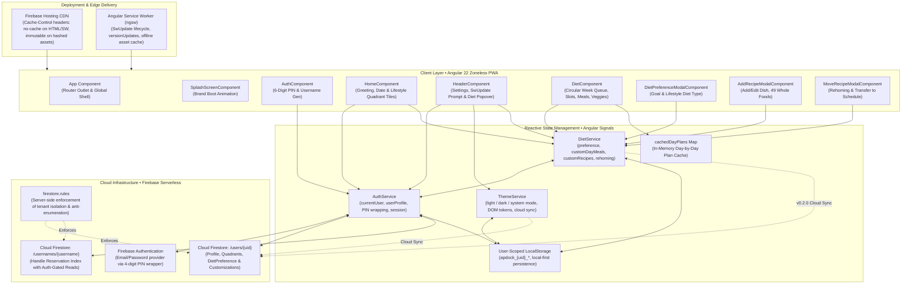
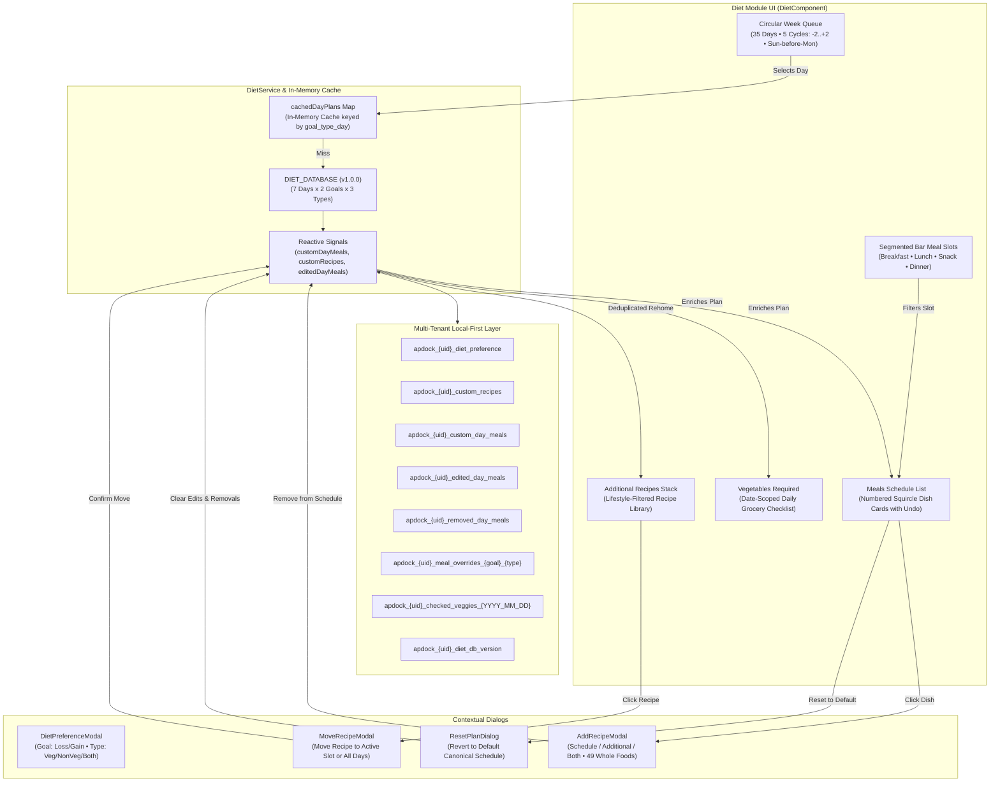

# apdock • Technical & System Architecture

> **Document Status**: Production Architecture Baseline (Audited Reality Baseline — Hardening In Progress)  
> **Target Version**: v0.1.0 (Phased Hardening & Security Implementation)  
> **Tech Stack**: Angular v22.2 (Zoneless Signal Architecture), Firebase Authentication, Cloud Firestore (Lite), Local-First Storage, Mobile-First PWA  
> **Last Audited**: October 2026 (Phase 0 Reality Check Complete)

---

## 1. System Architecture Overview

apdock is an agency-grade, mobile-first Progressive Web Application (PWA) designed as a personal lifestyle operating dock. It is engineered with a **Local-First & One-Shot Cloud Sync Architecture**:

- **Local-First Resilience**: Immediate client-side operations (UI state, schedule customizations, meal overrides, recipe rehoming) are committed to user-scoped browser storage for instant $0\text{ms}$ tactile interaction and complete offline availability.
- **Cloud Persistence via Firestore Lite**: Remote persistence uses `firebase/firestore/lite`, executing stateless HTTP/2 REST RPCs. **Architectural Realism**: Firestore Lite does *not* support real-time WebSocket listeners (`onSnapshot`) or native IndexedDB offline persistence; it is intentionally selected to reduce JavaScript bundle overhead by ~80% compared to the full Firebase SDK. Cloud synchronizations occur explicitly at write boundaries and session hydration checkpoints.
- **Security & Threat Model**: 6-digit PIN authentication is mapped client-side to synthetic email/password credentials (`${handle}@auth.apdock.internal`) for Firebase Auth compatibility, backed by server-side Cloud Firestore Security Rules, App Check anti-bot gating, and strict tenant isolation. Zero Firestore reads occur prior to authentication.



---

## 2. Frontend Architecture (Angular 22 Zoneless)

### 2.1 Technical Foundation
- **Framework**: Angular v22.2.0 (100% Standalone Component Architecture, zero `NgModule`).
- **Change Detection**: Modern Zoneless Reactive Signal Architecture configured via `provideZonelessChangeDetection()` in [app.config.ts](../src/app/app.config.ts). Zone.js is completely excluded from the bundle for minimal footprint and optimal CPU frame budgets.
- **Reactivity Model**:
  - `signal()`: Atomic writable reactive state primitives.
  - `computed()`: Pure, memoized derivations executing synchronously when dependencies mutate.
  - `effect()`: Synchronized reactive side-effects for Firestore backend updates and `localStorage` syncing.
- **Routing & Navigation**: Angular Router configured with functional guards:
  - `authGuard`: Enforces active user session, redirecting unauthenticated traffic to `/auth`.
  - `guestGuard`: Prevents authenticated sessions from accessing `/auth`, redirecting immediately to `/home`.

### 2.2 Component Hierarchy & Responsibilities

| Component | Selector | Relative Path | Status | Key Responsibilities |
|---|---|---|---|---|
| **App Root** | `app-root` | [app.ts](../src/app/app.ts) | IMPLEMENTED | Application shell hosting `<router-outlet>` and `<app-splash-screen>`. |
| **SplashScreen** | `app-splash-screen` | [splash-screen.component.ts](../src/app/components/splash-screen/splash-screen.component.ts) | IMPLEMENTED | 4-quadrant brand boot animation (`amber`, `emerald`, `violet`, `coral`), smooth spring fade-out on initialization. |
| **AuthComponent** | `app-auth` | [auth.component.ts](../src/app/pages/auth/auth.component.ts) | IMPLEMENTED | PIN Sign In and auto-generating Sign Up with animated progress indicator. |
| **HeaderComponent** | `app-header` | [header.component.ts](../src/app/components/header/header.component.ts) | PARTIAL | Universal sticky header: user avatar, handle tag, 3-mode theme switcher, sign out, account deletion, and diet popover (SwUpdate PWA updater planned). |
| **HomeComponent** | `app-home` | [home.component.ts](../src/app/pages/home/home.component.ts) | IMPLEMENTED | Time-calibrated greeting, live formatted date, and lifestyle quadrant module navigation tiles (Health Quadrant: Diet active, Gym planned). |
| **DietComponent** | `app-diet` | [diet.component.ts](../src/app/pages/diet/diet.component.ts) | IMPLEMENTED | Core nutrition cockpit: 5-cycle circular week queue, calibrated meal timing slots, in-memory day plan caching, meals list, vegetables checklist, and additional recipes stack. |
| **DietPreferenceModal** | `app-diet-preference-modal` | [diet-preference-modal.component.ts](../src/app/components/diet-preference-modal/diet-preference-modal.component.ts) | IMPLEMENTED | Squircle-based preference modal: Goal selection (`loss` / `gain`) and Lifestyle Diet Type (`veg` / `nonveg` / `both`). Used for first-time onboarding and on-demand reconfiguration. |
| **AddRecipeModal** | `app-add-recipe-modal` | [add-recipe-modal.component.ts](../src/app/components/add-recipe-modal/add-recipe-modal.component.ts) | IMPLEMENTED | Multi-destination recipe creator/editor: supports Day Meal Schedule, Additional Recipes, or Both; dynamic tag input with curated whole foods. |
| **MoveRecipeModal** | `app-move-recipe-modal` | [move-recipe-modal.component.ts](../src/app/components/move-recipe-modal/move-recipe-modal.component.ts) | IMPLEMENTED | Interactive sheet for transferring any additional recipe into Breakfast, Lunch, or Dinner on the active day, with option to edit recipe directly or apply across the schedule. |

---

## 3. Reactive State Management & Service Architecture

### 3.1 `AuthService` (`src/app/core/services/auth.service.ts`)
The identity and session backbone of apdock:
- **Firebase Auth Lifecycle**: Listens to `onAuthStateChanged` and exposes `currentUser` and `userProfile` signals.
- **PIN Key Derivation & Threat Model (Option B • Spark Tier)**:
  - User 6-digit PINs are transformed into Firebase-compatible password strings (`apdock_pin_${pin}_secure`).
  - **Honest Security Analysis**: Client-side string wrapping is NOT cryptographic hashing. Because Apdock operates on the Firebase Spark tier without Cloud Functions, password verification is handled by Firebase Auth Email/Password provider using synthetic client-derived credentials.
  - **Mitigation Architecture**:
    1. **6-Digit PIN Minimum**: Exactly 6 digits with validation rejecting trivial PINs (e.g. `000000`, `123456`, repeating digits, or sequences), expanding the raw keyspace to $1,000,000$ combinations.
    2. **App Check Enforcement & Spark Plan Finding**:
       - Web app registration with Firebase App Check (`ReCaptchaV3Provider`) initialized before any Auth or Firestore calls, with debug tokens (`FIREBASE_APPCHECK_DEBUG_TOKEN = true`) for local dev (`localhost`, `127.0.0.1`) and emulator.
       - **Enforcement Capability on Spark Tier**:
         - **Cloud Firestore**: App Check enforcement is fully supported and enforceable on the Spark (free) plan.
         - **Firebase Authentication**: App Check enforcement for Email/Password authentication is **not supported on the Spark plan** (requires Identity Platform / Blaze upgrade).
         - **Residual Risk**: Direct unauthenticated bot attacks against the synthetic Firebase Auth endpoints cannot be blocked by App Check at the Auth layer on the free plan. Compensating controls: 6-digit PIN ($1,000,000$ combinations), non-trivial PIN strength validator, zero unauthenticated Firestore reads, and Firebase Auth built-in rate limiting and email enumeration protection.
    3. **Anti-Enumeration Rules & Firebase Console Step**:
       - Cloud Firestore security rules strictly block unauthenticated reads, preventing handle/email enumeration.
       - **Console Step**: In Firebase Console > Authentication > Settings > User actions, verify and enable **"Email enumeration protection"** to ensure identical error responses for existing vs non-existent accounts.
    4. **Client UX Backoff**: Progressive client-side delay for user experience. Note: client backoff is UX only and is not a cryptographic or server-side security lockout.
    5. **Account Recovery**: (Planned) Optional verified recovery email or one-time recovery code shown once at sign-up.
- **Safe Cascade Account Deletion Workflow**:
  To eliminate race conditions and avoid orphaned Firebase Auth accounts:
  1. **Pre-Reauthentication**: The user re-enters their 6-digit PIN immediately prior to deletion. The client executes `reauthenticateWithCredential()`. If re-authentication fails or credentials are stale, deletion halts *before* any Firestore records are touched.
  2. **Batched Firestore Deletion**: `/users/{uid}` and `/usernames/{username}` are deleted inside a single atomic `writeBatch()`.
  3. **Auth Record Deletion**: `deleteUser(firebaseUser)` is invoked.
  4. **User-Scoped Local Storage Purge**: All `apdock_${uid}_*` local keys and `apdock_profile_${uid}` are removed from the browser.
  5. **Orphan Recovery Marker**: If `deleteUser` fails after Firestore documents are deleted, a `pending-auth-deletion` marker is recorded locally to retry deletion on next launch (best-effort on Spark tier without Admin SDK Cloud Functions).
- **Sign-Out Protocol**:
  - Invokes `firebaseSignOut(auth)`.
  - Terminates active reactive signals (`currentUser.set(null)`, `userProfile.set(null)`).
  - Clears `sessionStorage`. User-scoped data (`apdock_${uid}_*`) remains securely isolated by UID in `localStorage` for the next session without cross-user leakage.

### 3.2 `ThemeService` (`src/app/core/services/theme.service.ts`)
Controls application aesthetics across platforms with cloud synchronization:
- Supports 3 modes: `'light'`, `'dark'`, and `'system'`.
- Synchronizes the `data-theme` attribute on `<html>` and updates `<meta name="theme-color">` dynamically (`#080b13` for dark, `#ffffff` for light).
- Listens to OS theme changes via `window.matchMedia('(prefers-color-scheme: dark)')`.
- **Bidirectional Cloud Sync**: Caches locally in `localStorage` for instantaneous splash boot, and synchronizes to `/users/{uid}.themePreference` in Cloud Firestore whenever changed by an authenticated user.

### 3.3 `DietService` (`src/app/core/services/diet.service.ts`)
The single source of truth for nutrition, recipes, and schedule customization:
- **Preference Management**: Tracks `goal` (`'loss'` | `'gain'`) and `dietType` (`'veg'` | `'nonveg'` | `'both'`).
- **User-Scoped Storage & Cloud Sync Roadmap**:
  - **v0.1.0 Storage Model**: All customizations are scoped under `apdock_${uid}_*` (e.g., `apdock_${uid}_custom_recipes`, `apdock_${uid}_custom_day_meals`, `apdock_${uid}_edited_day_meals`, `apdock_${uid}_removed_day_meals`, `apdock_${uid}_meal_overrides`, `apdock_${uid}_checked_veggies_${date}`).
  - **v0.2.0 Cloud Sync Model**: Custom recipes, schedule edits, and removed meals sync to Firestore subcollection `/users/{uid}/diet/customizations`. Optimistic local updates ensure zero UI latency while debounced writes persist to the cloud, protecting users against device changes, browser cache clearing, and Safari 7-day ITP data eviction.
- **Calibrated Meal Timing Thresholds**:
  Adjusted to reflect realistic meal windows:
  - `06:00 - 11:30`: `'breakfast'` (Morning Plan)
  - `11:30 - 16:00`: `'lunch'` (Midday Plan)
  - `16:00 - 19:30`: `'snack'` (Evening Snack / Pre-Workout Slot)
  - `19:30 - 23:59` & `00:00 - 06:00`: `'dinner'` (Night Plan)
- **Database Schema Versioning (`DIET_DATABASE_VERSION`)**:
  - `DIET_DATABASE` is tagged with a semantic version (e.g. `1.0.0`).
  - Stored modifications record `dbVersion`. If a future release updates meal IDs, a migration reconciliation routine checks stored override/edit IDs against the new schema, pruning invalid references without crashing.
- **Goal/Type Override Scoping**:
  - `meal_overrides` are keyed by `${goal}_${dietType}_${day}_${slot}`. Changing goals (e.g., from `gain` to `loss`) does not cause stale, non-existent dish IDs to be loaded.
- **Vegetable Checklist Date Scoping**:
  - Checked vegetables are scoped by date: `apdock_${uid}_checked_veggies_${YYYY_MM_DD}`. The checklist automatically resets at midnight (00:00) each day.
- **Reset to Standard Plan & Undo Architecture**:
  - Users can invoke "Reset Day Plan" or "Reset Week Plan", clearing `removed_day_meals` and `edited_day_meals` for the target scope.
  - Automated recipe rehoming checks for existing recipes by title/signature before inserting to prevent duplicate entries in Additional Recipes.

---

## 4. In-Depth Diet Module Architecture



### 4.1 Circular Week Queue Algorithm
1. **Virtual Sequence**: Generates 5 complete 7-day cycles (cycles `-2, -1, 0, 1, 2 = 35` items total).
2. **Canonical Sequence**: `Sunday, Monday, Tuesday, Wednesday, Thursday, Friday, Saturday`. Sunday is always strictly adjacent to Monday across all cycles.
3. **Centered Auto-Scroll (`centerChipByIndex`)**: Uses `container.scrollTo()` with calculated offsets (`chipLeft - (containerWidth / 2) + (chipWidth / 2)`) to place the active day in the dead center of the viewport.
4. **Shortest Circular Distance**: When a day is selected programmatically, the selector computes the shortest circular path ($-3 \dots +3$ chips) to avoid jarring horizontal jumps.
5. **Queue Normalization (`scheduleQueueNormalization`)**: When scrolling into edge cycles (cycle $-2$ or $+2$), the queue silently normalizes the index back to the middle cycle ($0$) after 400ms without triggering layout shifts.

### 4.2 On-Demand 1-Day Data Fetching & Caching
- **Bundle Reality & Remote Roadmap**:
  - In v0.1.0, `DIET_DATABASE` is bundled as an in-app data module to guarantee offline execution without remote API dependencies. The shimmer card animation maintains visual rhythm and prevents Cumulative Layout Shift (CLS = 0) during computation and signal propagation.
  - In v0.2.0, seasonal/curated diet plans will be served via Cloud Firestore / Cloudflare CDN endpoints, cached locally in IndexedDB/CacheStorage for zero-latency offline recall.
- **In-Memory Cache (`cachedDayPlans`)**: Keyed by `${goal}_${dietType}_${day}`. Subsequent tab switches between already-loaded days are instant ($0\text{ms}$).

---

## 5. Backend Architecture, Cloud Infrastructure & Security Rules

### 5.1 Cloud Infrastructure Stack
- **Authentication**: Firebase Authentication (Email/Password provider adapted via 6-digit PIN wrapper with App Check and anti-enumeration controls).
- **Database**: Cloud Firestore (using `firebase/firestore/lite` for minimal client bundle overhead).
- **Hosting & Edge**: Firebase Hosting (Global SSD CDN, HTTP/2 multiplexing, automatic SSL).

### 5.2 Server-Side Security Rules (`firestore.rules`)
Client-side document isolation is strictly enforced at the database layer via Cloud Firestore Security Rules (Option B Hardened Rules):

```javascript
rules_version = '2';
service cloud.firestore {
  match /databases/{database}/documents {

    // Helper functions
    function isAuthenticated() {
      return request.auth != null;
    }

    function isOwner(userId) {
      return isAuthenticated() && request.auth.uid == userId;
    }

    function isValidDietPreference(pref) {
      return pref is map
        && pref.keys().hasOnly(['goal', 'dietType', 'updatedAt'])
        && pref.keys().hasAll(['goal', 'dietType'])
        && (pref.goal in ['loss', 'gain'])
        && (pref.dietType in ['veg', 'nonveg', 'both'])
        && (!('updatedAt' in pref) || (pref.updatedAt is string && pref.updatedAt.size() <= 50) || (pref.updatedAt is timestamp));
    }

    function isValidUserDoc(data) {
      let allowedKeys = [
        'uid',
        'username',
        'displayName',
        'email',
        'photoURL',
        'createdAt',
        'lastLoginAt',
        'themePreference',
        'dietPreference',
        'quadrants',
        'pendingAuthDeletion'
      ];
      return data.keys().hasOnly(allowedKeys)
        && data.keys().hasAll(['uid', 'username', 'createdAt', 'lastLoginAt'])
        && data.uid is string && data.uid == request.auth.uid
        && data.username is string && data.username.matches('^[a-z0-9]{3,20}$')
        && data.createdAt is timestamp
        && data.lastLoginAt is timestamp
        && (!('displayName' in data) || data.displayName == null || (data.displayName is string && data.displayName.size() <= 60))
        && (!('email' in data) || data.email == null || (data.email is string && data.email.size() <= 120))
        && (!('photoURL' in data) || data.photoURL == null || (data.photoURL is string && data.photoURL.size() <= 500))
        && (!('themePreference' in data) || (data.themePreference in ['system', 'light', 'dark']))
        && (!('dietPreference' in data) || isValidDietPreference(data.dietPreference))
        && (!('quadrants' in data) || (data.quadrants is map && data.quadrants.size() <= 10))
        && (!('pendingAuthDeletion' in data) || (data.pendingAuthDeletion is bool));
    }

    // =========================================================================
    // Username Reservation Index: /usernames/{h}
    // =========================================================================
    match /usernames/{h} {
      allow get: if isAuthenticated();
      allow list: if false;
      allow create: if isAuthenticated()
        && request.resource.data.keys().hasOnly(['uid', 'createdAt'])
        && request.resource.data.keys().hasAll(['uid', 'createdAt'])
        && request.resource.data.uid == request.auth.uid
        && request.resource.data.createdAt == request.time
        && h.matches('^[a-z0-9]{3,20}$');
      allow update: if false;
      allow delete: if isAuthenticated() && resource.data.uid == request.auth.uid;
    }

    // =========================================================================
    // User Profile Document: /users/{uid}
    // =========================================================================
    match /users/{uid} {
      allow get: if isOwner(uid);
      allow list: if false;
      allow create: if isOwner(uid)
        && request.resource.data.createdAt == request.time
        && isValidUserDoc(request.resource.data);
      allow update: if isOwner(uid)
        && isValidUserDoc(request.resource.data)
        && request.resource.data.uid == resource.data.uid
        && request.resource.data.username == resource.data.username
        && request.resource.data.createdAt == resource.data.createdAt;
      allow delete: if isOwner(uid);

      // Subcollections reserved for v0.2 sync (denied for now)
      match /{sub=**} {
        allow read, write: if false;
      }
    }

    // =========================================================================
    // Default Deny Rule
    // =========================================================================
    match /{document=**} {
      allow read, write: if false;
    }
  }
}
```

### 5.3 Firestore Document Schemas

#### Collection: `/users/{uid}`
```typescript
interface UserProfile {
  uid: string;                       // Firebase Auth UID
  username: string;                  // Unique handle (e.g., "alex", "alex1")
  email: string | null;              // User email address (null for synthetic PIN users)
  displayName: string | null;        // Full name formatted
  photoURL: string | null;           // User avatar URL
  createdAt?: unknown;               // Firestore server timestamp
  lastLoginAt?: unknown;             // Firestore server timestamp
  themePreference?: 'system' | 'light' | 'dark';
  dietPreference?: {
    goal: 'loss' | 'gain';
    dietType: 'veg' | 'nonveg' | 'both';
    updatedAt: string;               // ISO 8601 timestamp
  };
  quadrants?: {
    health: { title: string; enabled: boolean };
    flow: { title: string; enabled: boolean };
    family: { title: string; enabled: boolean };
    home: { title: string; enabled: boolean };
  };
}
```

#### Subcollection: `/users/{uid}/diet/customizations` *(v0.2.0 Cloud Sync)*
```typescript
interface UserDietCustomizations {
  customRecipes: AdditionalRecipe[];
  customDayMeals: CustomDayMeal[];
  editedDayMeals: Record<string, EditedDayMeal>;
  removedDayMealIds: string[];
  mealOverrides: Record<string, string>;
  updatedAt: string;
  dbVersion: string;
}
```

#### Collection: `/usernames/{username}`
Acts as a unique reservation index ensuring handle uniqueness across all accounts:
```typescript
interface UsernameIndexRecord {
  uid: string;                       // Owner UID matching request.auth.uid
  createdAt: unknown;                // Server timestamp (request.time)
  // Note: No email or displayName stored here
}
```

### 5.4 Multi-Tenant Storage Key Registry
All device keys are strictly isolated by `uid` to prevent data leakage on shared devices:

| Storage Key Pattern | Type | Scope & Purpose | Status |
|---|---|---|---|
| `apdock_{uid}_diet_preference` | `DietPreference` | Active goal (`loss`/`gain`) and diet type (`veg`/`nonveg`/`both`). | PLANNED (Phase 2 Migration) |
| `apdock_{uid}_custom_recipes` | `AdditionalRecipe[]` | User-created and rehomed recipes in Additional Recipes pool. | PLANNED (Phase 2 Migration) |
| `apdock_{uid}_custom_day_meals` | `CustomDayMeal[]` | Custom dishes added directly to a specific day and slot. | PLANNED (Phase 2 Migration) |
| `apdock_{uid}_edited_day_meals` | `Record<string, EditedDayMeal>` | User modifications to standard schedule meals. | PLANNED (Phase 2 Migration) |
| `apdock_{uid}_removed_day_meals` | `string[]` | IDs of dishes removed from the schedule. | PLANNED (Phase 2 Migration) |
| `apdock_{uid}_meal_overrides_{goal}_{type}` | `Record<string, string>` | User's selected meal option IDs per `${day}_${slot}`, scoped by goal & diet type. | PLANNED (Phase 2 Migration) |
| `apdock_{uid}_checked_veggies_{YYYY_MM_DD}` | `string[]` | Date-scoped grocery checklist, auto-resetting daily at midnight. | PLANNED (Phase 2 Migration) |
| `apdock_{uid}_diet_db_version` | `string` | Version tag for stored customization schema reconciliation. | PLANNED |
| `apdock_{uid}_theme_preference` | `'system' \| 'light' \| 'dark'` | User's local theme selection before cloud sync. | PLANNED |
| `apdock_user_{username}` | `string` | Fast-path local handle-to-email mapping (contains real emails). | LEGACY (Purging in Phase 1/2) |
| `apdock_profile_{uid}` | `UserProfile` | Offline cached user profile document. | IMPLEMENTED |

---

## 6. Progressive Web App (PWA), Service Worker & Edge CDN Caching

### 6.1 Service Worker Strategy (`SwUpdate`)
Rather than executing destructive `caches.delete()` calls that wipe service worker caches and break offline operation:
1. **Angular Service Worker Integration**: Uses `@angular/service-worker` via `SwUpdate`.
2. **Version Readiness Event**: Subscribes to `swUpdate.versionUpdates` filtering for `VersionReadyEvent`.
3. **Non-Intrusive Update Notification**: Prompts the user with a subtle in-app toast: *"A new version of apdock is ready."* with a **Reload** button.
4. **Controlled Activation**: Invoking update calls `swUpdate.activateUpdate().then(() => document.location.reload())`, ensuring clean cache rotation without putting the service worker into a degraded state.

### 6.2 Edge CDN Caching Headers (`firebase.json`)
Edge CDN and browser cache rules are configured to prevent stale client bundles:

```json
{
  "hosting": {
    "public": "dist/apdock/browser",
    "headers": [
      {
        "source": "/index.html",
        "headers": [
          { "key": "Cache-Control", "value": "no-cache, no-store, must-revalidate" }
        ]
      },
      {
        "source": "/@(ngsw.json|ngsw-worker.js|sw.js|manifest.webmanifest)",
        "headers": [
          { "key": "Cache-Control", "value": "no-cache, no-store, must-revalidate" }
        ]
      },
      {
        "source": "**/*.@(js|css)",
        "headers": [
          { "key": "Cache-Control", "value": "public, max-age=31536000, immutable" }
        ]
      },
      {
        "source": "**/*.@(jpg|jpeg|gif|png|svg|webp|woff|woff2|ico)",
        "headers": [
          { "key": "Cache-Control", "value": "public, max-age=31536000, immutable" }
        ]
      }
    ]
  }
}
```

---

## 7. Lifestyle Quadrant Architecture Alignment

The apdock system schema defines four macro lifestyle dimensions:
1. **Health & Wellness**: Active diet planning, nutrition goals, grocery lists, and workout tracking.
2. **Daily Flow & Tasks**: Habits, daily priorities, and focus routines.
3. **Family & Tribe**: Shared family schedules, key dates, and collective routines.
4. **Home & Sanctuary**: Living space maintenance, domestic inventories, and space management.

**Home UI Mapping**: The current Home screen surfaces primary lifestyle modules belonging to the **Health & Wellness Quadrant**:
- **Diet Plan**: Active, production-ready nutrition cockpit.
- **Gym Schedule**: Next scheduled lifestyle module under the Health Quadrant.
- **Subsequent Quadrants**: Quadrant tiles for Flow, Family, and Home are scheduled in the product roadmap, expanding the home dock into the full 4-quadrant grid.

---

## 8. Health, Nutritional Guidance & Medical Disclaimer

apdock is a personal organization dock and lifestyle planning tool. It is **not** a medical device, and the dietary suggestions, macro breakdowns, and meal plans provided are for informational and educational purposes only.

- **Non-Prescriptive Guidance**: Plans do not account for individual metabolic conditions, pregnancy, renal pathology, diabetes, food allergies, or medical treatment plans.
- **Medical Consultation Requirement**: Users embarking on significant caloric surplus or deficit regimens must consult a certified medical practitioner or registered dietitian.
- **Eating Disorder Consideration**: The interface prioritizes clean, whole-food suggestions and zero obsessive calorie-counting overhead, intentionally avoiding micro-logging patterns that trigger dietary anxiety.
