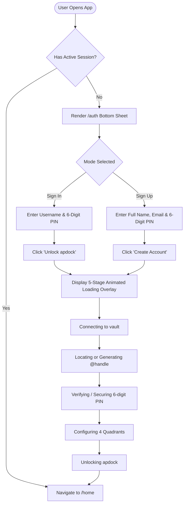
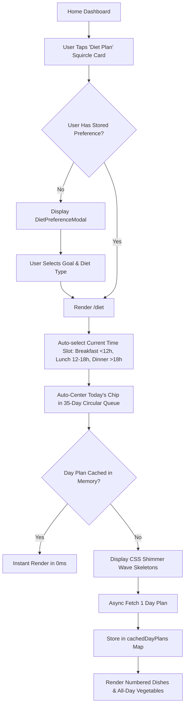
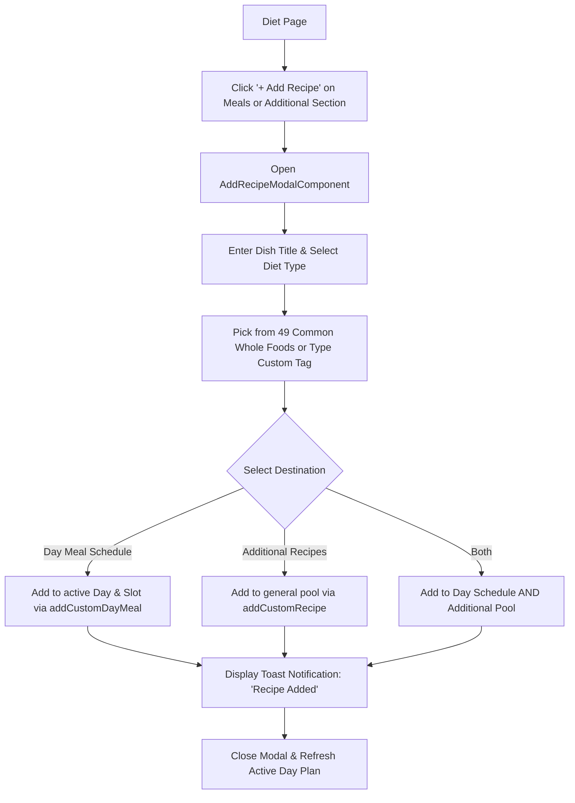
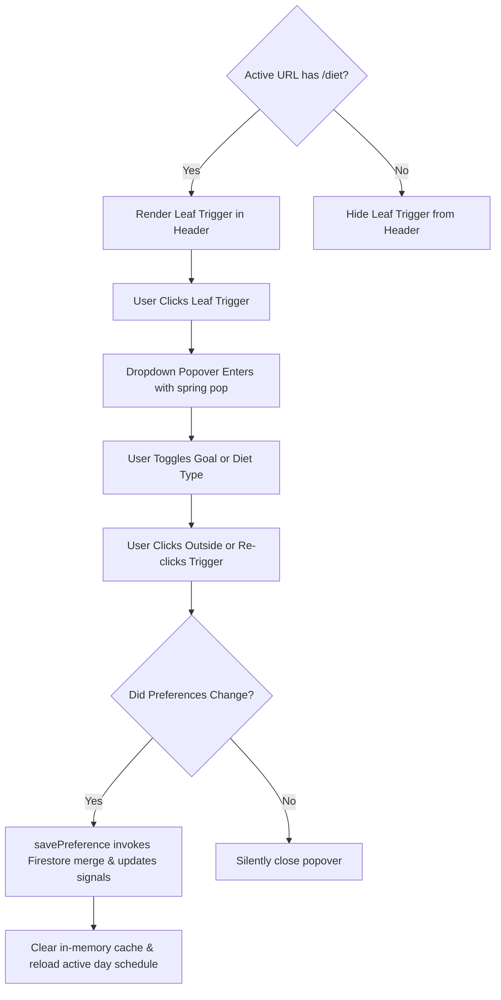
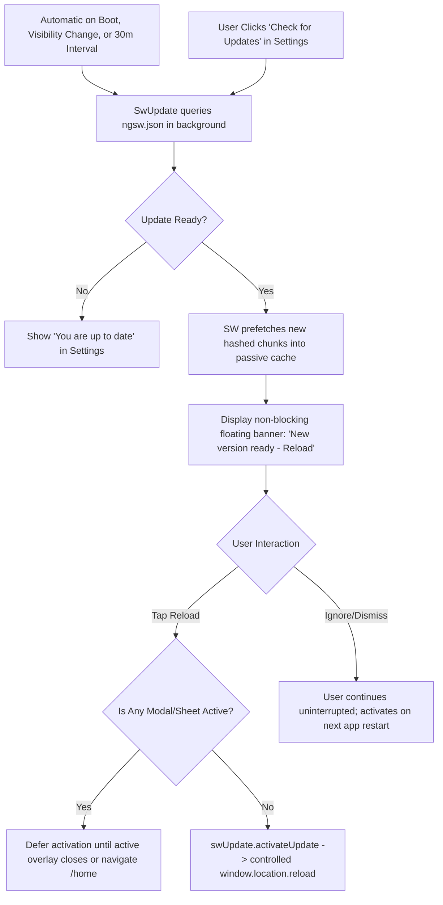

# apdock • UI Design System, Layout Tokens & Frontend Flow Specification

> **Design Standard**: Agency-Grade Luxury Minimalism (Inspired by Apple Health, Linear, Superhuman)  
> **Framework**: Angular v22.2 (Zoneless Signals), Mobile-First Responsive PWA  
> **Last Updated**: October 2026

---

## 1. Core Visual Philosophy

1. **Anti-Clutter Architecture (Zero Nested Borders)**:
   - Never nest borders inside borders (e.g., an icon container box inside an option card inside a section card).
   - The interactive container *itself* serves as the touch target, status indicator, and visual anchor.
2. **Contextual Progressive Disclosure**:
   - Surface controls only where and when they are strictly relevant.
   - *Example*: The **Diet Preference** icon button in `<app-header>` is rendered *only* when the user is navigated inside `/diet`, eliminating unnecessary controls from the Home screen.
3. **Tactile Spring Physics**:
   - Interactive elements respond to contact with physical spring compression (`transform: scale(0.965)`) and smooth cubic-bezier recovery.
   - Mobile tap highlight flash is universally eliminated (`-webkit-tap-highlight-color: transparent !important`).
4. **Adaptive Dark & Light Luminance**:
   - **Dark Mode**: Deep obsidian foundations (`#080b13` to `#0f1422`), translucent card fills (`rgba(20, 27, 44, 0.72)`), frosted inner borders (`inset 0 1px 0 rgba(255, 255, 255, 0.1)`), and glowing accents.
   - **Light Mode**: Clean slate foundations (`#f8fafc` to `#ffffff`), crisp borders (`rgba(0, 0, 0, 0.08)`), soft cyan/sky diffuse shadows, and vibrant gradient brand titles.
5. **Zero Cumulative Layout Shift (CLS = 0)**:
   - All asynchronous state changes (loading days, expanding form fields, showing error banners) use predefined geometry and CSS shimmer wave skeletons to prevent page jumps.

---

## 2. Design Tokens & Color Palette

### 2.1 Quadrant Identity Accents
Derived from the signature 4-quadrant application identity:

| Token | HEX Code | Dark Mode Glow | Usage & Semantics |
|---|---|---|---|
| `--brand-sky` | `#0084ff` | `rgba(0, 132, 255, 0.35)` | Primary brand blue, focus rings, link accents, submit buttons |
| `--brand-cyan` | `#00c6ff` | `rgba(0, 198, 255, 0.35)` | Weight Loss highlight, active synergy gradients |
| `--quad-amber` | `#ff9f0a` | `rgba(255, 159, 10, 0.35)` | Weight Gain goal, Family quadrant, alert accents |
| `--quad-emerald` | `#30d158` / `#10b981` | `rgba(16, 185, 129, 0.40)` | Vegetarian preference, Health quadrant, active day chips, success toasts |
| `--quad-violet` | `#5e5ce6` | `rgba(94, 92, 230, 0.35)` | Flow & Tasks quadrant, gradient transitions |
| `--quad-coral` | `#ff453a` / `#f43f5e` | `rgba(255, 69, 58, 0.35)` | Non-Veg preference, Gym module, destructive actions |

---

### 2.2 System Theme Token Matrix

```css
/* ==========================================================================
   CSS Custom Properties Architecture (src/styles.css)
   ========================================================================== */

/* Dark Mode Tokens (Default & [data-theme='dark']) */
:root, [data-theme='dark'] {
  --bg-deep: #080b13;
  --bg-surface: #0f1422;
  --bg-card: rgba(20, 27, 44, 0.72);
  --border-card: rgba(255, 255, 255, 0.09);
  --card-shadow: 0 16px 40px -8px rgba(0, 0, 0, 0.5), inset 0 1px 0 rgba(255, 255, 255, 0.1);
  --text-primary: #f8fafc;
  --text-secondary: rgba(248, 250, 252, 0.75);
  --text-muted: rgba(248, 250, 252, 0.48);
  --btn-bg: rgba(255, 255, 255, 0.06);
  --btn-border: rgba(255, 255, 255, 0.11);
  --btn-color: #f8fafc;
  --btn-hover-bg: rgba(255, 255, 255, 0.11);

  /* Splash Screen Tokens */
  --splash-bg: #070a12;
  --splash-title-color: #ffffff;
  --splash-title-grad: linear-gradient(180deg, #ffffff 30%, rgba(255, 255, 255, 0.85) 100%);
  --splash-icon-shadow: 0 18px 45px -10px rgba(0, 132, 255, 0.4), 0 6px 18px -4px rgba(0, 0, 0, 0.5);
  --splash-icon-border: 1px solid rgba(255, 255, 255, 0.06);

  /* Home Greeting Display Name */
  --greeting-name-color: #ffffff;
  --greeting-name-fill: #ffffff;
  --greeting-name-bg: none;
  --greeting-name-clip: border-box;
  --greeting-name-shadow: drop-shadow(0 2px 16px rgba(255, 255, 255, 0.14));

  /* Home Lifestyle Module Cards */
  --card-diet-bg: linear-gradient(160deg, rgba(16, 185, 129, 0.13) 0%, rgba(20, 27, 44, 0.78) 55%, rgba(13, 18, 33, 0.88) 100%);
  --card-diet-border: rgba(48, 209, 88, 0.24);
  --card-diet-shadow: 0 14px 34px -8px rgba(0, 0, 0, 0.4), 0 0 20px -4px rgba(48, 209, 88, 0.14), inset 0 1px 0 rgba(255, 255, 255, 0.14);

  --card-gym-bg: linear-gradient(160deg, rgba(255, 69, 58, 0.13) 0%, rgba(20, 27, 44, 0.78) 55%, rgba(13, 18, 33, 0.88) 100%);
  --card-gym-border: rgba(255, 69, 58, 0.24);
  --card-gym-shadow: 0 14px 34px -8px rgba(0, 0, 0, 0.4), 0 0 20px -4px rgba(255, 69, 58, 0.14), inset 0 1px 0 rgba(255, 255, 255, 0.14);
}

/* Light Mode Overrides ([data-theme='light']) */
[data-theme='light'] {
  --bg-deep: #f8fafc;
  --bg-surface: #ffffff;
  --bg-card: rgba(255, 255, 255, 0.85);
  --border-card: rgba(0, 0, 0, 0.08);
  --card-shadow: 0 20px 45px -12px rgba(0, 132, 255, 0.12), 0 8px 24px -4px rgba(0, 0, 0, 0.04);
  --text-primary: #0f172a;
  --text-secondary: #475569;
  --text-muted: #64748b;
  --btn-bg: rgba(0, 0, 0, 0.05);
  --btn-border: rgba(0, 0, 0, 0.12);
  --btn-color: #0f172a;
  --btn-hover-bg: rgba(0, 0, 0, 0.09);

  /* Splash Screen Tokens */
  --splash-bg: #ffffff;
  --splash-title-color: #090d16;
  --splash-title-grad: linear-gradient(180deg, #090d16 20%, #1e293b 100%);
  --splash-icon-shadow: 0 20px 45px -10px rgba(0, 132, 255, 0.25), 0 8px 24px -6px rgba(0, 0, 0, 0.08);
  --splash-icon-border: 1px solid rgba(0, 0, 0, 0.06);

  /* Home Greeting Display Name */
  --greeting-name-color: transparent;
  --greeting-name-fill: transparent;
  --greeting-name-bg: linear-gradient(135deg, var(--brand-sky) 0%, var(--quad-violet) 45%, var(--quad-coral) 100%);
  --greeting-name-clip: text;
  --greeting-name-shadow: drop-shadow(0 4px 18px rgba(0, 132, 255, 0.22));

  /* Home Lifestyle Module Cards */
  --card-diet-bg: linear-gradient(160deg, rgba(236, 253, 245, 0.95) 0%, rgba(255, 255, 255, 0.98) 60%);
  --card-diet-border: rgba(48, 209, 88, 0.28);
  --card-diet-shadow: 0 4px 16px -2px rgba(16, 185, 129, 0.12), 0 2px 6px -1px rgba(15, 23, 42, 0.04);

  --card-gym-bg: linear-gradient(160deg, rgba(255, 241, 240, 0.95) 0%, rgba(255, 255, 255, 0.98) 60%);
  --card-gym-border: rgba(255, 69, 58, 0.28);
  --card-gym-shadow: 0 4px 16px -2px rgba(255, 69, 58, 0.12), 0 2px 6px -1px rgba(15, 23, 42, 0.04);
}
```

---

## 3. Spacing, Margin & Padding System

### 3.1 Base Spacing Scale
The spacing architecture follows a strict 4px/8px modular rhythm:

| Token | Value | Common Application |
|---|---|---|
| `space-1` | `4px` | Micro-badge gap, inner dot offset, segmented button internal padding |
| `space-2` | `8px` | Icon-to-text gap, chips spacing, header action buttons gap, card item gaps |
| `space-3` | `12px` | Meal cards gap, dish number badge padding, option rows spacing |
| `space-4` | `16px` | Page horizontal padding on mobile, week queue section margins, card grid gap |
| `space-5` | `18px` | Card internal padding (`18px 18px`), modal vertical element gap |
| `space-6` | `20px` | Home main horizontal padding, modal header vertical padding |
| `space-7` | `24px` | Form groups bottom margin, desktop modal outer padding |
| `space-8` | `28px` | Section bottom padding, card bottom offset |
| `space-9` | `32px` | Home layout bottom padding, auth sheet slide distance |

### 3.2 Responsive Container Geometry
- **Global Max Width**:
  - Global Header: `max-width: 1200px` (centered).
  - Auth Page Container: `max-width: 440px`.
  - Home Page Container: `max-width: 460px`.
  - Diet Page Container: `max-width: 480px`.
  - Modal Sheets & Dialogs: `max-width: 460px` (mobile bottom sheet, desktop centered modal).
- **Safe Area Insets**:
  - Integrated via CSS environment variables:
    ```css
    --sat: env(safe-area-inset-top, 0px);
    --sab: env(safe-area-inset-bottom, 0px);
    --sal: env(safe-area-inset-left, 0px);
    --sar: env(safe-area-inset-right, 0px);
    ```

---

## 4. Typography Scale & Hierarchy

- **Primary Body & Display**: `Plus Jakarta Sans`, -apple-system, BlinkMacSystemFont, 'SF Pro Display', system-ui, sans-serif.
- **Monospace & Codes**: `JetBrains Mono`, SFMono-Regular, Menlo, Monaco, monospace (for PIN digits, timestamps, macros).

| Typography Role | Font Size | Weight | Line Height | Letter Spacing | CSS Context |
|---|---|---|---|---|---|
| **Hero Greeting Name** | `clamp(44px, 13vw, 62px)` | 900 (Black) | `1.15` | `-0.035em` | `.gradient-name` |
| **Auth Brand Title** | `28px` | 800 (Bold) | `1.10` | `-0.035em` | `.brand-title` |
| **Page / Header Title** | `19px` | 700 (Bold) | `1.00` | `-0.025em` | `.brand-name` |
| **Modal / Section Title** | `17px - 18px` | 800 (Bold) | `1.20` | `-0.015em` | `.options-panel-title`, `.sheet-title` |
| **Dish Card Name** | `13.5px` | 600 (Semibold) | `1.45` | `normal` | `.dish-name`, `.recipe-name` |
| **Segmented Tab Label** | `13.5px` | 700 (Bold) | `1.00` | `normal` | `.tab-label` |
| **Input Value Text** | `14px - 16px` | 500 / 600 | `1.40` | `normal` | `.form-input` (`16px` on mobile prevents iOS auto-zoom) |
| **PIN Input Code** | `16px` | 600 | `1.00` | `0.12em` | `.pin-input` (JetBrains Mono) |
| **Micro Badge & Number** | `11px` | 800 (Bold) | `1.00` | `+0.04em` | `.dish-num-badge`, `.popover-section-label` |

---

## 5. Border Radius & Elevation Architecture

### 5.1 Corner Radii Hierarchy

| Radius | Usage | Classes |
|---|---|---|
| `6px` | Micro badges, ingredient tags | `.dish-num-badge`, `.recipe-ing-item`, `.modal-pill` |
| `8px` | Sub-action text buttons, eye icon button | `.link-edit-recipe`, `.toggle-eye-btn` |
| `10px` | Brand icon frame in header, step rows | `.brand-logo-frame`, `.step-row` |
| `11px` | Segmented meal timing button active pill | `.segmented-btn` |
| `12px` | Parallel action triggers, toast icon badge | `.diet-pref-trigger-btn`, `.settings-trigger-btn`, `.toast-icon-badge` |
| `13px - 14px` | Form inputs, slot grid buttons, toast popup card | `.form-input`, `.slot-btn`, `.toast-popup`, `.veg-item-card` |
| `16px` | Day chips, scheduled dish cards | `.day-chip`, `.dish-card` |
| `18px` | Panel sections, popover menu cards | `.panel-section`, `.diet-pref-popover` |
| `22px - 26px` | Bottom sheet modals, lifestyle squircle cards | `.sheet-modal-card`, `.squircle-card`, `.modal-sheet` |
| `34px - 36px` | Auth bottom sheet container | `.auth-card` |
| `9999px` | Circular buttons, pill tabs, back button | `.nav-back-btn`, `.submit-btn`, `.btn-add-recipe` |

### 5.2 Elevation & Shadows
- **Card Ambient Shadow (Dark)**: `0 16px 40px -8px rgba(0, 0, 0, 0.5), inset 0 1px 0 rgba(255, 255, 255, 0.1)`
- **Card Ambient Shadow (Light)**: `0 20px 45px -12px rgba(0, 132, 255, 0.12), 0 8px 24px -4px rgba(0, 0, 0, 0.04)`
- **Emerald Glow**: `0 4px 16px rgba(16, 185, 129, 0.40)`
- **Toast Dynamic Island Shadow**: `0 16px 36px -8px rgba(0, 0, 0, 0.75), 0 0 18px rgba(16, 185, 129, 0.18)`
- **Frosted Glass Blur**: `backdrop-filter: blur(20px)` on header, `blur(28px)` on popovers and modals.

---

## 6. Page-by-Page Detailed Layout & Style Specifications

---

### 6.1 Authentication Screen (`AuthComponent`)

```
┌───────────────────────────────────────────────┐
│              [Ambient Pastel Aura]            │
│                                               │
│             ┌───────────────────┐             │
│             │   Brand Icon 64px │             │
│             └───────────────────┘             │
│                    apdock                     │
│          Your personal lifestyle space        │
│                                               │
│ ┌───────────────────────────────────────────┐ │
│ │  [ Sign In ]   [ Create Account ]         │ │
│ │                                           │ │
│ │  Username (@)   [_______________]         │ │
│ │  Security PIN   [ • • • • ]   (👁️)         │ │
│ │                                           │ │
│ │  [        Unlock apdock  →       ]        │ │
│ └───────────────────────────────────────────┘ │
└───────────────────────────────────────────────┘
```

- **Root Layout (`.auth-page-root`)**:
  - `min-height: 100dvh`, `justify-content: flex-end`, `background: var(--bg-deep)`.
- **Pastel Aura Blobs (`.ambient-glow`)**:
  - 4 absolute blobs (`blob-sky`, `blob-amber`, `blob-emerald`, `blob-coral`), `filter: blur(85px)`, `opacity: 0.35`, 10s alternate keyframe animation (`blobMotion`).
- **Brand Header (`.auth-header`)**:
  - Icon Wrapper: `64x64px`, `border-radius: 19px`, `box-shadow: var(--splash-icon-shadow)`, floating animation (`gentleIconFloat`).
  - Title: `28px`, `800 weight`, gradient text clip.
- **Bottom-Anchored Card (`.auth-card`)**:
  - Mobile: `border-radius: 36px 36px 0 0`, `padding: 24px 22px calc(var(--sab) + 26px)`.
  - Desktop: `max-width: 440px`, `border-radius: 34px 34px 28px 28px`, `margin-bottom: 24px`.
  - Backdrop blur: `28px`.
- **Mode Switcher (`.mode-tabs`)**:
  - Container: `height: 38px`, `border-radius: 999px`, `padding: 3px`, background `var(--btn-bg)`.
  - Animated Indicator Pill (`.tab-indicator-pill`): `width: calc(50% - 3px)`, `border-radius: 999px`, sliding smoothly with `transform 0.32s cubic-bezier(0.32, 0.72, 0, 1)`.
- **Form Inputs (`.form-input`)**:
  - `padding: 11px 14px 11px 40px`, `border-radius: 16px`, background `var(--bg-surface)`, focus ring `0 0 0 3px rgba(0, 132, 255, 0.15)`.
  - PIN Input: letter-spacing `0.12em`, `font-family: var(--font-mono)`.
- **Submit Action (`.submit-btn`)**:
  - Height: `48px`, `border-radius: 999px`, background `linear-gradient(135deg, var(--brand-sky) 0%, #00b4d8 100%)`, shadow `0 10px 25px -5px rgba(0, 132, 255, 0.45)`.
- **Progressive Staged Loading Overlay (`.loading-overlay`)**:
  - Opaque card `#0e1220` (dark) / `#ffffff` (light), z-index `30`.
  - Orbiting quadrant cluster: 4 pearls (`pearl-amber`, `pearl-emerald`, `pearl-violet`, `pearl-coral`) orbiting in a 76x76px radius (`orbitSpin 3.6s infinite`).
  - 4-Color Progress Bar: `height: 6px`, `border-radius: 999px`, background `linear-gradient(90deg, amber, emerald, sky, violet)`.

---

### 6.2 Home Screen (`HomeComponent`)

```
┌───────────────────────────────────────────────┐
│ [Brand Logo] apdock                     (⚙️)   │
├───────────────────────────────────────────────┤
│ Good evening,                                 │
│ Alex River                    [ Sun, Oct 25 ] │
│                                               │
│                                               │
│ ┌──────────────────────┐ ┌──────────────────┐ │
│ │  🌿 Diet Plan        │ │  🏋️ Gym Schedule │ │
│ │  Personalized Meals  │ │  Upcoming        │ │
│ └──────────────────────┘ └──────────────────┘ │
└───────────────────────────────────────────────┘
```

- **Container (`.home-container`)**:
  - `max-width: 460px`, `padding: 16px 20px calc(var(--sab) + 32px)`, `justify-content: space-between`.
- **Greeting Section (`.user-greeting-section`)**:
  - Eyebrow: `13px`, `600 weight`, `--brand-sky`.
  - Display Name: `clamp(44px, 13vw, 62px)`, `900 weight`, `-0.035em tracking`.
    - Dark mode: luminous white `#ffffff`, drop-shadow `0 2px 16px rgba(255, 255, 255, 0.14)`.
    - Light mode: triple gradient clip (sky $\rightarrow$ violet $\rightarrow$ coral).
  - Date Badge: `font-size: 12px`, `padding: 6px 12px`, `border-radius: 999px`, backdrop blur `14px`.
- **Lifestyle Module Cards Grid (`.cards-grid`)**:
  - 2-column grid (`gap: 16px`), aligned to bottom (`margin-top: auto`).
  - Card Dimensions: aspect-ratio `4 / 3.6`, `min-height: 148px`, `border-radius: 26px`.
  - Card Diet: Mint/Emerald glow, icon squircle `46x46px`, `border-radius: 14px`.
  - Card Gym: Coral/Amber glow with "Upcoming" status pill.

---

### 6.3 Global Header & Action Controls (`HeaderComponent`)

- **Sticky Container (`.app-header`)**:
  - `position: sticky; top: 0`, `z-index: 50`, `backdrop-filter: blur(20px)`, `border-bottom: 1px solid var(--border-card)`.
  - Container padding: `calc(var(--sat) + 12px) 16px 12px`.
- **Left Identity (`.header-brand`)**:
  - Squircle Logo Frame: `36x36px`, `border-radius: 10px`, logo image `32x32px`.
  - Brand Title: `19px`, `700 weight`, `-0.025em tracking`.
- **Right Action Buttons (`.header-actions`)**:
  - Both buttons measure `38px x 38px`, `border-radius: 12px`, `gap: 8px`.
  - **Diet Preference Trigger (`#dietPrefTriggerBtn`)**:
    - Contextual: rendered only when routed inside `/diet`.
    - Active State: emerald background `rgba(48, 209, 88, 0.12)`, border `#30d158`, leaf icon rotates 50deg with glow.
  - **Settings Trigger (`#settingsTriggerBtn`)**:
    - Active State: rotates gear icon 60deg with spring pop.
- **Diet Preference Popover (`.diet-pref-popover`)**:
  - Anchored at `top: calc(100% + 10px)`, `right: 0`, `width: 285px`, `border-radius: 18px`, `padding: 12px`, backdrop blur `28px`.
  - Segmented Rows: Goal (2 cols) and Diet Type (3 cols) with active border and backlight glow.
- **Settings Dropdown (`.settings-dropdown`)**:
  - Theme switcher segmented control (`Light`, `Dark`, `System`), "Check for Updates" action button, Sign Out button, and destructive Account Deletion button.

---

### 6.4 Diet Management Screen (`DietComponent`)

```
┌───────────────────────────────────────────────┐
│ [← Home]                               (🌿)(⚙️)│
├───────────────────────────────────────────────┤
│ [ MON ] [ TUE ] [ *WED* ] [ THU ] [ FRI ]     │ <- Circular Week Track
│                                               │
│ [  Breakfast  ]  [ *Lunch* ]  [  Dinner  ]    │ <- 3 Meal Timing Slots
│                                               │
│ Meals                         [+ Add Recipe]  │
│ ┌───────────────────────────────────────────┐ │
│ │ 01  Paneer Tikka & Sautéed Broccoli       │ │
│ └───────────────────────────────────────────┘ │
│                                               │
│ Vegetables Required                  All Day  │
│ ┌───────────────────────────────────────────┐ │
│ │ Fresh Spinach (Palak)         Leafy Green │ │
│ └───────────────────────────────────────────┘ │
│                                               │
│ Additional Recipes            [+ Add Recipe]  │
│ ┌───────────────────────────────────────────┐ │
│ │ Grilled Chicken & Bell Peppers            │ │
│ │ [Chicken] [Bell Peppers] [Olive Oil]      │ │
│ └───────────────────────────────────────────┘ │
└───────────────────────────────────────────────┘
```

- **Layout Container (`.diet-container`)**:
  - `max-width: 480px`, `padding: 16px 16px 28px`, `gap: 16px`.
- **Top Navigation (`.nav-back-btn`)**:
  - Pill `border-radius: 9999px`, `padding: 7px 13px`, `font-size: 13px`, `600 weight`, chevron left icon `15x15px`.
- **Circular Week Queue (`.week-queue-track`)**:
  - Section negative margin: `0 -16px` (spans full viewport edge-to-edge).
  - Scroll snap: `x mandatory`, padding `0 calc(50% - 31px)` for dead-center active chip alignment.
  - Day Chip (`.day-chip`): `width: 62px`, `height: 52px`, `border-radius: 16px`, `background: var(--bg-surface)`.
  - Active Chip: background `#10b981`, text `#ffffff`, border `#10b981`, shadow `0 4px 16px rgba(16, 185, 129, 0.4)`.
  - Active press physics: `transform: scale(0.93)`.
- **Meal Timing Bar (`.segmented-bar`)**:
  - 3-column grid (`grid-template-columns: repeat(3, 1fr)`), `border-radius: 14px`, `padding: 3px`.
  - Buttons (`.segmented-btn`): `border-radius: 11px`, `padding: 10px 8px`, label `13.5px`, `700 weight`.
- **Numbered Meals List (`.options-list`)**:
  - Dish Card (`.dish-card`): `min-height: 64px`, `border-radius: 16px`, `padding: 14px 18px`.
  - Number Badge (`.dish-num-badge`): `11px`, `800 weight`, `#10b981`, background `rgba(16, 185, 129, 0.1)`, `padding: 3px 7px`, `border-radius: 6px`.
  - Dish Name (`.dish-name`): `13.5px`, `600 weight`, line-height `1.45`.
  - Hover: `transform: translateY(-1px)`, border `rgba(16, 185, 129, 0.45)`.
  - Active: `transform: scale(0.985)`.
- **Shimmer Skeletons (`.shimmer-wave`)**:
  - Animated gradient moving horizontally `animation: shimmerMove 1.5s infinite linear`.
  - Card skeleton: `height: 98px`, `border-radius: 16px`, title line `12px`, body line `16px`.
- **All-Day Vegetables Panel (`.panel-section`)**:
  - Card: `border-radius: 18px`, `padding: 18px`.
  - Veggie Item (`.veg-item-card`): `min-height: 66px`, `border-radius: 14px`, `padding: 14px 18px`, background `var(--bg-deep)`.
  - Veggie Name: `13.5px`, `600 weight`. Category: `11px`, `500 weight`, `--text-muted`.
- **Additional Recipes Stack (`.recipes-stack`)**:
  - Clean Recipe Card (`.clean-recipe-card`): `min-height: 72px`, `border-radius: 14px`, `padding: 16px 18px`, background `var(--bg-deep)`.
  - Ingredients Strip: wrap flexbox, chip `font-size: 11px`, `padding: 3px 8px`, `border-radius: 6px`, background `var(--btn-bg)`.
- **Toast Floating Notification (`.toast-popup`)**:
  - Floating Dynamic Island style: `bottom: calc(var(--sab) + 24px)`, `left: 50%`, `transform: translateX(-50%)`.
  - Dimensions: `min-width: 270px`, `max-width: min(92vw, 380px)`, `border-radius: 14px`, backdrop blur `16px`.
  - Icon Badge: `28x28px`, `border-radius: 9px`, emerald `#34d399` with checkmark.
  - Typography: Title `13px` bold, subtitle `11.5px` muted with ellipsis truncation.

---

### 6.5 Add / Edit Recipe Modal (`AddRecipeModalComponent`)

- **Backdrop**: `position: fixed; inset: 0`, background `rgba(3, 7, 18, 0.74)`, `backdrop-filter: blur(14px)`.
- **Card Geometry**:
  - Desktop: `max-width: 460px`, `border-radius: 22px`, centered.
  - Mobile: `border-radius: 26px 26px 0 0`, `max-height: 88dvh`, slide up from bottom.
- **Header (`.sheet-header`)**:
  - Title Icon Badge: `40x40px`, `border-radius: 12px`, background `rgba(16, 185, 129, 0.14)`.
  - Title: `1.18rem`, `800 weight`. Subtitle: `0.8rem`, `500 weight`.
- **Input Fields (`.form-input`)**:
  - Uniform height: `48px`, `border-radius: 13px`, `padding: 0 16px`, `font-size: 16px`.
- **Diet Type Selector (`.type-seg-btn`)**:
  - 2-column grid, uniform height `48px`, `border-radius: 13px`.
  - Veg active: background `rgba(16, 185, 129, 0.14)`, border `rgba(16, 185, 129, 0.55)`, color `#34d399`.
  - Non-veg active: background `rgba(244, 63, 94, 0.14)`, border `rgba(244, 63, 94, 0.55)`, color `#fb7185`.
- **Ingredient Tag Picker**:
  - Search wrapper: `height: 48px`, `border-radius: 13px`, icon `16x16px`.
  - Autocomplete dropdown: `border-radius: 14px`, `max-height: 190px`, background `#1a2333`.
  - Selected Chips: `height: 32px`, `border-radius: 9999px`, `padding: 0 8px 0 12px`, background `rgba(16, 185, 129, 0.12)`, remove button `18x18px`.
- **Footer Actions (`.sheet-footer`)**:
  - Primary Row: 2-column equal-width grid.
  - Cancel Button: `height: 48px`, `border-radius: 14px`, background `rgba(255, 255, 255, 0.05)`.
  - Submit Button: `height: 48px`, `border-radius: 14px`, background `linear-gradient(135deg, #10b981 0%, #059669 100%)`.
  - Remove from Schedule Link: subtle red text button `#f87171` triggering confirmation dialog.

---

### 6.6 Move Recipe to Schedule Sheet (`MoveRecipeModalComponent`)

- **Geometry**: Bottom sheet sliding up on mobile (`max-height: 85vh`, `border-radius: 24px 24px 0 0`), centered card on desktop (`border-radius: 22px`).
- **Header**:
  - Eyebrow: `0.68rem`, `800 weight`, emerald `#10b981`.
  - Diet pill tag: `border-radius: 9999px`, `padding: 3px 9px`.
  - Dish Title: `1.22rem`, `700 weight`, line-height `1.35`.
  - Ingredients: `0.8rem`, `500 weight`, line-clamp `2`.
- **Slot Selector Grid (`.slot-segmented-grid`)**:
  - 3-column grid (`Breakfast`, `Lunch`, `Dinner`).
  - Button (`.slot-btn`): `height: 54px`, `border-radius: 13px`, background `rgba(255, 255, 255, 0.035)`.
  - Active button: emerald background `rgba(16, 185, 129, 0.12)`, border `#10b981`, pop scale animation `optionScalePop`.
- **Footer**:
  - Primary button: `height: 48px`, `border-radius: 14px`, emerald gradient, text "Move to Schedule".
  - Secondary link: "Edit Recipe Details" in sky blue `#38bdf8`.

---

### 6.7 Diet Preference Modal (`DietPreferenceModalComponent`)

- **Geometry**: Centered squircle card `max-width: 420px`, `border-radius: 24px`.
- **Interactive Tiles (`.pref-tile`)**:
  - Minimum height `68px`, `border-radius: 16px`.
  - Active Goal Tile (Loss): Cyan border `#00c6ff`, gradient backlight, glow `0 0 20px -3px rgba(0, 198, 255, 0.32)`.
  - Active Goal Tile (Gain): Amber border `#ff9f0a`, gradient backlight, glow `0 0 20px -3px rgba(255, 159, 10, 0.32)`.
  - Active Diet Tile (Veg): Emerald border `#30d158`, glow `0 0 20px -3px rgba(48, 209, 88, 0.32)`.
  - Active Diet Tile (Non-Veg): Coral border `#ff453a`, glow `0 0 20px -3px rgba(255, 69, 58, 0.32)`.
- **Confirm Button**: `height: 50px`, `border-radius: 14px`, background `linear-gradient(135deg, #10b981 0%, #0084ff 100%)`.

---

### 6.8 Splash Screen (`SplashScreenComponent`)

- **Full Screen Overlay**: `position: fixed; inset: 0`, `z-index: 9999`, background `var(--splash-bg)`.
- **Center Squircle**: `80x80px`, `border-radius: 24px`, ambient backlight shadow.
- **Quadrant Dots Cluster**: 4 dots positioned in a $2 \times 2$ grid representing the lifestyle quadrants:
  - Top-Left: Warm Amber `#ff9f0a` (Family).
  - Top-Right: Vivid Emerald `#30d158` (Health & Wellness).
  - Bottom-Left: Deep Violet `#5e5ce6` (Flow & Tasks).
  - Bottom-Right: Soft Coral `#ff453a` (Home & Sanctuary).
- **Exit Motion**: Smooth spring fade-out (`opacity: 1 -> 0`, `pointer-events: none`).

---

## 7. Complete Frontend User Flows

---

### Flow 1: Authentication & Account Creation



---

### Flow 2: Daily Meal Browsing & Day Queue Navigation



---

### Flow 3: Recipe Addition Flow (Schedule, Additional, Both)



---

### Flow 4: Recipe Removal & Automated Rehoming Flow

```mermaid
flowchart TD
    SCHEDULE_DISH[Scheduled Dish in Meals List] --> CLICK_DISH[User Clicks Dish Card]
    CLICK_DISH --> OPEN_EDIT_MODAL[Open Edit Modal with Dish Pre-filled]
    OPEN_EDIT_MODAL --> CLICK_REMOVE[Click 'Remove from Schedule' Red Button]
    CLICK_REMOVE --> SHOW_CONFIRM[Display Confirmation Dialog]
    SHOW_CONFIRM --> CONFIRM_YES[User Confirms Removal]

    CONFIRM_YES --> REMOVE_ID[Add dish.id to removedDayMealIds & LocalStorage]
    REMOVE_ID --> AUTO_REHOME[Auto-invoke addCustomRecipe with dish name and ingredients]
    AUTO_REHOME --> SAVE_ADDITIONAL[Dish immediately appears in Additional Recipes Stack]
    SAVE_ADDITIONAL --> TOAST_REHOME[Show Toast: '"{Dish Name}" moved to Additional Recipes']
    TOAST_REHOME --> CLOSE_MODAL[Close Dialog & Refresh Schedule List]
```

---

### Flow 5: Additional Recipe Migration Flow (Additional $\rightarrow$ Schedule)

```mermaid
flowchart TD
    ADDITIONAL_STACK[Additional Recipes Stack] --> CLICK_RECIPE[User Clicks Recipe Card]
    CLICK_RECIPE --> OPEN_MOVE_SHEET[Open MoveRecipeModalComponent]
    OPEN_MOVE_SHEET --> SELECT_SLOT[User Selects Target Slot: Breakfast, Lunch, or Dinner]
    SELECT_SLOT --> CONFIRM_MOVE[Click 'Move to Schedule']

    CONFIRM_MOVE --> ADD_DAY_MEAL[addCustomDayMeal created for active day and chosen slot]
    ADD_DAY_MEAL --> REMOVE_FROM_POOL[removeAdditionalRecipe cleans up recipe from Additional pool]
    REMOVE_FROM_POOL --> UPDATE_STORAGE[Persist updated arrays to LocalStorage]
    UPDATE_STORAGE --> TOAST_MOVE[Show Toast: '"{Title}" → [Day] · [Slot]']
    TOAST_MOVE --> CLOSE_MOVE_SHEET[Close Move Sheet & Switch active slot filter to target slot]
```

---

### Flow 6: Header Contextual Diet Popover Flow



---

### Flow 7: PWA Check for Updates & Non-Destructive Lifecycle Flow



---

## 8. Accessibility & Micro-Interactions Standard

1. **Color Contrast AA Standard**: Primary text passes WCAG 2.2 AA ($> 4.5:1$) contrast against dark obsidian (`#080b13`) and light slate (`#f8fafc`).
2. **Keyboard Focus Rings**: Custom `:focus-visible` ring across all interactive controls (`outline: 2px solid var(--brand-sky); outline-offset: 2px`).
3. **Hardware Escape Listener**: Pressing `Escape` universally dismisses modals, dropdowns, and confirmation sheets without state corruption.
4. **Scroll Locking**: All modal openings automatically apply `.modal-open` on `<html>` and `<body>`, saving scroll positions and preventing mobile background pull-to-refresh interference.
5. **Screen Reader Compliance**: Every icon button without visible text provides an explicit, descriptive `aria-label` (e.g., `"Back to home"`, `"Add meal recipe"`, `"Move recipe to schedule"`).
